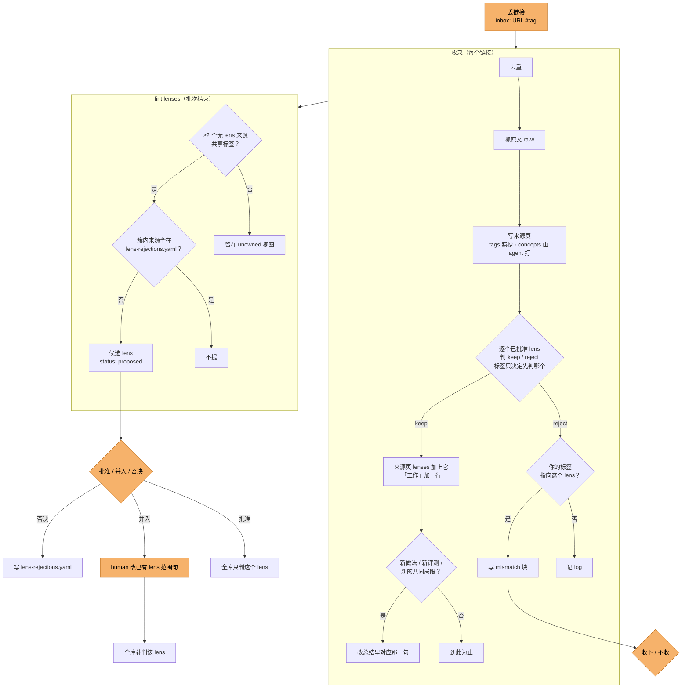

# exocortex 设计决策

**研究方向（lens 的范围句）由人定；每个方向一段中立总结和每个工作一行的 highlight，由 LLM 维护；只有 LLM 与你的标签不一致时才等人。** 来源平铺，不做人工分类。

执行细节以 [AGENTS.md](../AGENTS.md) 为准。

## 全流程与 human 决策点

橙色是只有 human 能做的一步，其余由 agent 按 `AGENTS.md` 自动完成。

| human 决策点 | 什么时候出现 | 粒度 | 已知摩擦 |
|---|---|---|---|
| 丢链接、打标签 | 随时 | 每条链接 | 近义标签不会自动对齐，靠 [human-tags.md](human-tags.md) 自查 |
| 批准 / 并入 / 否决候选 lens | lint 提出候选后 | 每个候选 | 「也可并入」没有判据 |
| 改已有 lens 范围句 | 并入时，或研究方向变了 | 每个 lens | — |
| 收下 / 不收 | 你的标签指向某个 lens，LLM 却 reject | 每条冲突 | — |
| 改错标签 | 发现时 | 每个来源 | 来源页与 lens 页的 `tags` 要分别改 |

查询、收录、lint 都不经过 human；agent 只在上面这几处停下来等人。

## lens：一个方向的总结与各工作要点

- **lens 是一个窄方向，不是大主题。** 「机器人」不是 lens；「冻结的前沿模型当 agent、在模型外写代码技能来驱动机器人操作的工作」是。范围句只描述方向包含什么，不写它要服务的决策。
- **范围一句话，判定只有 keep / reject。** 一句话足够 LLM 判（取自 embodied_radar 的 `domain.yaml`）。
- **每个工作一行 highlight 是 lens 的主体**：做了什么、最重要的结果、自报还是第三方。只写它自己，不与其它工作比较；细节在来源页。
- **总结 2–3 句、中立**：方向里有哪几类工作、证据共有的局限；不逐个点名，不排高下，不写建议。
- **不打强度分。** 「可信度」列只写自报 / 第三方、评测次数、是否开源；压成「强 / 中 / 弱」，LLM 判不一致。
- **LLM 直接写，人事后改。** 逐条预审曾积压 26 条草稿、一条没人批。
- **只有标签冲突才等人**：你的标签指向某个 lens、按内容却 reject，写 `[!mismatch]`。

## 标签：人打的是线索，LLM 打的只作检索

- **human 标签**（`tags`）：丢链接时打的 `#jev`。人没细看也知道大概方向，这个意图从原文推不出来，成本只有一个词。
  它决定先判哪个 lens，归属仍按内容定，否则一次打错就把来源塞进错的问题。lens 的 `tags` 记录它对应哪些 human 标签。
- **LLM 标签**（`concepts`）：3–6 个方法或主张标签，用于检索和兜底成簇；不建概念页（r3–r5 建过 13 页，太宽或太碎，查询也不需要）。

## lens 之外的来源：提议新 lens

进来的来源多半不属于任何已有问题（t4 里 6 个新链接有 5 个被所有 lens reject）。

- 两个以上无 lens 来源共享一个标签（先比 human 标签）→ LLM 起草 `status: proposed` 的候选 lens，默认以该标签命名。
- 候选不参与收录判定，未批准的问题不吸新来源。
- 只有人能批准 / 并入 / 否决；批准后全库补判，否决过的簇没有新来源加入就不再提。
- **规则要读的状态不放 log。** 否决记录是 lint 唯一要查的状态，单独存 `wiki/lens-rejections.yaml`；log 只作审计，按事件或来源名搜索，避免随规模增长被整份读进上下文；它不承载状态，所以只留本地，不进仓库，也免去每次收录追加带来的合并冲突。

## 结构与校验

- **三层**（[Karpathy llm-wiki](https://gist.github.com/karpathy/442a6bf555914893e9891c11519de94f)）：`raw/` 原文写一次不改，是事实出处；
  `wiki/` 每条事实可追回 `raw/`；`AGENTS.md` 是 agent 唯一操作手册。raw 只放原始来源，不放别人的综合页。
- **不分主题文件夹、不手写 index。** 手写分类会混轴且要人维护（3dgen_tracker 的 9 类留一法一致性仅 0.42–0.93）；索引由 Obsidian Bases 从 frontmatter 生成。
- **校验不依赖 Obsidian 运行**：`check_wiki.py` 直接解析文件，lens 页查四节齐全，且「工作」的行与来源页 `lenses` 一一对应；查询由无上下文 agent 作答，题目见 [query-eval.md](query-eval.md)。

## 放弃的方案

| 方案 | 原因 |
|---|---|
| 手写 index / 主题分类 | 不可扩展，混轴 |
| 不设 lens，全靠来源聚类 | 聚类给不出一个方向的整体概貌 |
| 每个 lens 一张多列对比表 | 各工作的评测口径不一，横比多半不成立，细节反而喧宾夺主 |
| LLM 自建 lens | 研究方向是人的 |
| 问题 → 判断 → 证据（决策问题、带支持 / 限定 / 反驳的判断） | 问题由 LLM 起草，不是人的真实决策；判断只增不减、重复来源页；反驳从未触发过 |
| 每个共享概念建一页 | 太宽或太碎，维护成本随来源数增长 |
| 现在上 embedding 聚类 | 来源才十几个，共享标签够用；上百后再说 |
| 判断改动逐条等人批 | 26 条草稿没人批，判断停在建库时 |
| 一句话「当前判断」 | 带倾向的结论，看不出依据与可信度 |
| 强 / 中 / 弱 强度档、数值置信度、遗忘曲线（LLM Wiki v2） | 档位判不一致、精度是假的；来源才二十几个 |
| Discourse Graphs 插件 | 依赖 Datacore，每条主张一页，文件数翻倍 |

## 已知缺口

- 「也可并入」没有判据。
- 来源本身后来被撤回或证伪时，没有规则回头清理它在 lens 里的那一行。
- 总结是否中立、highlight 是否忠实于来源页，不受校验。
- 「工作」行数随来源线性增长，没有拆分规则。
- 没打 human 标签的来源只能靠 LLM 标签成簇，标签名漂移会漏簇（44 个标签里 31 个只出现一次）。
- 收录要人在对话里触发，尚无无头触发。
