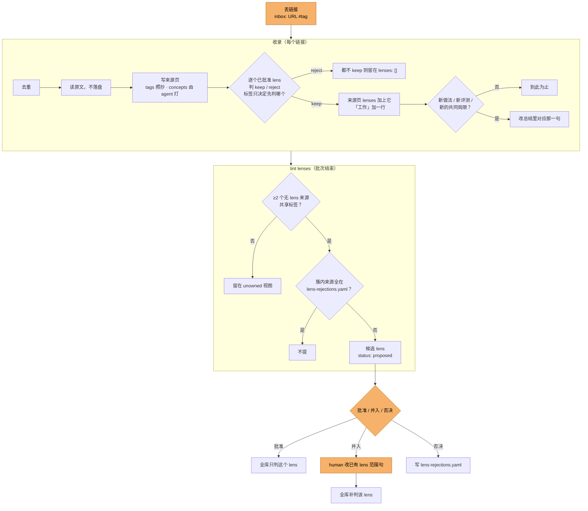

# exocortex 设计决策

**研究方向（lens 的范围句）由人定；每个方向一段中立总结和每个工作一行的 highlight，由 LLM 维护；只有建立新方向时才等人。** 来源平铺，不做人工分类。
来源除了 human 丢的链接，还有 `feed/` 每天从 human 的关注网络里挑出的工作：直接收录，human 只撤销不要的。

执行细节以 [AGENTS.md](../AGENTS.md) 为准。

## 全流程与 human 决策点

橙色是只有 human 能做的一步，其余由 agent 按 `AGENTS.md` 自动完成。

| human 决策点 | 什么时候出现 | 粒度 | 已知摩擦 |
|---|---|---|---|
| 丢链接、打标签 | 随时 | 每条链接 | 近义标签不会自动对齐，靠 [human-tags.md](human-tags.md) 自查 |
| 批准 / 并入 / 否决候选 lens | lint 提出候选后 | 每个候选 | 「也可并入」没有判据 |
| 改已有 lens 范围句 | 并入时，或研究方向变了 | 每个 lens | — |
| 改错标签 | 发现时 | 每个来源 | 来源页与 lens 页的 `tags` 要分别改 |

查询、收录、lint 都不经过 human；agent 只在上面这几处停下来等人。

## lens：一个方向的总结与各工作要点

- **lens 是一个窄方向，不是大主题。** 「机器人」不是 lens；「冻结的前沿模型当 agent、在模型外写代码技能来驱动机器人操作的工作」是。范围句只描述方向包含什么，不写它要服务的决策。
- **范围一句话，判定只有 keep / reject。** 一句话足够 LLM 判。
- **每个工作一行 highlight 是 lens 的主体**：做了什么、最重要的结果、自报还是第三方。只写它自己，不与其它工作比较；细节在来源页。
- **总结 2–3 句、中立**：方向里有哪几类工作、证据共有的局限；不逐个点名，不排高下，不写建议。
- **不打强度分。** 「可信度」列只写自报 / 第三方、评测次数、是否开源；压成「强 / 中 / 弱」，LLM 判不一致。
- **LLM 直接写，人事后改。** 逐条预审曾积压 26 条草稿、一条没人批。
- **标签与内容不一致时按内容判，不等人**：标签已定为线索，再请人逐条复核等于重审这条规则。
  被 reject 的来源保留标签、留在无 lens 池，由 lint 与后来的来源成簇。

## 图谱：看工作之间的关联

库的主要用途是看一个方向里的工作怎么互相关联，单条查询是次要的。Obsidian 图谱只有在「来源 ↔ 来源」有边时才有信息量；只有「lens → 来源」时，它画出的是 lens 归属，文字里已经有了。

- **边分两类**，取自 3dgen_tracker 的「承接」边：
  - 共享节点：链接形式、不建页面，两个来源连到同一个节点就有了关系。
    - `benchmarks`：报了数字的评测集，看哪些工作能放在同一个评测集上比；
    - `models_used` / `models_compared`：用到的模型与直接对照的模型，名字按 `docs/model-names.md` 规范化，否则 `Opus 5` 与 `Claude Opus 5` 会成两个节点；跨 lens 的边主要来自这里；
    - `methods`：至少两个来源共有的方法。只有一个来源的方法节点在图里是孤点，留在 concepts。
  - 「关联」：库内来源之间的 `基于` / `对照` / `相悖`，由 LLM 收录时读原文判定，双向查。相关工作里顺带一提的不连，3dgen 的引用边里 73% 是这类清单式引用。
- **字段粗、不抽细关系**：GSAP-ERE 上提示式 LLM 抽取细粒度关系只有 10.1%，微调模型 54%，所以只记「用了 / 对照了哪个模型」，角色写在正文里。
- **不用语义近邻边**：3dgen 的 FAISS 近邻要几千篇才有结构，二十几个来源时近邻多是噪声。
- **Obsidian 不按边的类型上色**，关系类型在来源页的「关联」一节里读。
- 图谱视图过滤掉 lens 页与文档，节点按 lens 上色；配置在 `.obsidian/graph.json`，不进仓库。

## 标签：人打的是线索，LLM 打的只作检索

- **human 标签**（`tags`）：丢链接时打的 `#jev`。人没细看也知道大概方向，这个意图从原文推不出来，成本只有一个词。
  它决定先判哪个 lens，归属仍按内容定，否则一次打错就把来源塞进错的问题。lens 的 `tags` 记录它对应哪些 human 标签。
- **LLM 标签**（`concepts`）：3–6 个方法或主张标签，用于检索和兜底成簇；不建概念页（早期建过 13 页，太宽或太碎，查询也不需要）。

## lens 之外的来源：提议新 lens

进来的来源多半不属于任何已有问题（早期一批 6 个新链接有 5 个被所有 lens reject）。

- 两个以上无 lens 来源共享一个标签（先比 human 标签）→ LLM 起草 `status: proposed` 的候选 lens，默认以该标签命名。
- 候选不参与收录判定，未批准的问题不吸新来源。
- **agent 发现方向，人建立方向。** 只有人能批准 / 并入 / 否决；批准后全库补判，否决过的簇没有新来源加入就不再提。
  这是全流程唯一的事前人工门：一个 lens 会持续吸收来源、决定总结怎么写，错建的代价随来源数增长；归属判错只影响一个来源，所以交给 agent。
- **规则要读的状态单独存，不记操作日志。** 否决记录是 lint 唯一要查的状态，存 `wiki/lens-rejections.yaml`；每次收录与 lens 判定写在 PR 描述里，审计靠 git 历史。曾有一份本地审计日志，没有规则读它，删掉。

## feed：替 human 读关注网络，撤销制收录

human 每天在 GitHub feed 上看到的项目和头部团队发布的东西，是他会主动丢进来的链接的主要来源。`feed/` 替他读，挑出的直接收录。

- **单位是工作**：一条候选是一个规范化 URL，挂着它在两个源里的全部信号。同一工作的仓库、论文、项目页还会被当成不同工作（PrismWAM 的仓库与项目页都被选中过），跨 URL 归并未做。
- **两个源**：GitHub feed（关注者 star / 新建 / 转公开、trending）与 `entities.yaml` 里头部团队的官方 blog、GitHub、Hugging Face。不接公众号与 X，是 human 定的范围。
- **只算人的动作**：GitHub 推荐卡与 fork 副本不算信号；创建或发布超过 180 天的不收；只有公司信号的工作 14 天内有候选资格，公司 blog 不是每天发，没有时效的话判过 yes 的旧文会一直占收录名额。
- **一个偏好判定，依据只来自 human 的行为**：最近 star 的仓库、近 90 天推送过的自己的仓库、标过 yes / no 的工作（否决与撤销都是 no）。每个工作只判一次。
  不给 lens 范围句：按 lens 判时判定退化成主题匹配，金标验收集精确率只有 6/12；lens 归类留给收录第 5 步。
- **上升或判 yes 进候选**：≥ 2 位关注者或 trending 的工作不经判定也进，其余看判定。
- **撤销制**：「feed 收录」每次直接收前 5 条，human 只说「删 X」，撤销的 URL 进 `search-rejections.yaml`，第二天成为判定的负例。
  先试过每批列 10 条请 human 挑，human 认为这把人留在了环里；撤销制下 human 不看也照样收，看了才删。
- **不设评测门、信任分、简报**：human 的标注少且有噪声，召回 / 精确率门只会卡住上线；判得好不好看撤销比例，和「以后 star 命中率」（判过之后才被 star 的工作里当时判 yes 的比例，只观察不当门）。
- **代码与 wiki 在同一仓库，数据不在**：否决表、判定代码、收录规则改一处即生效；谁 star 了什么、登录 cookie、判定记录只在运行机器的私有目录，仓库里只出现链接与一句理由。

## 搜索候选：只摆到 human 面前

- 搜索结果不像 feed 那样有人的动作背书，所以只写进 `inbox/proposals.md`，收不收仍由 human 定；agent 不写 `inbox/links.md`。
- SearXNG 按需在本机 Docker 起停，不常驻、不需要另一台服务器；只读结果摘要，不抓全文。
- 只留近 30 天；每次最多 10 条；按 URL、arXiv 编号与库内工作名去重，否决过的不再提。

## 发布与合并

- **网页只有一页**：已批准 lens 的工作行加一张 lens、来源与关联的关系图，页面不随来源数增长；标准库脚本加 vis-network，不引入 Node 或 Quartz。来源页细节、评测集 / 模型 / 方法节点留在仓库与 Obsidian。
- **收录类 PR 自动合并**：只碰来源页、lens、inbox、否决表等收录路径的 PR，`check-wiki` 通过即合并；碰到代码、规则、workflow 的等 human 合并。收录 PR 多且结构可校验，规则改动影响之后每一次收录。

## token 开销

量级很小，但每个环节都有 LLM 调用，记在这里，方便以后看哪一段在涨。

| 环节 | 调用方 | 开销 |
|---|---|---|
| feed 判定 | `feed/` 调 DeepSeek（`deepseek-flash`），每个新工作一次 | 每次输入约 2,800 token（约 70% 命中缓存）、输出约 90；2026-10-22 一天 17 次，输入 4.8 万、输出 1,500；至 2026-10-22 共 165 次，输入 41.9 万、输出 1.5 万 |
| 收录、lint、查询、删 X | human 对话里的编码 agent（Cursor、Claude Code 等） | 未计量：每条来源要读全文、写来源页、逐个 lens 判定，单条远大于一次判定，估计是总开销的大头 |
| 搜索候选 | SearXNG 不调模型；查询改写、排序与理由由对话里的 agent 写 | 未计量，每次一轮对话 |

- 判定的输入里 human 上下文（star、自己的仓库、标注例子）放在待判工作之前，跨调用前缀相同，所以多数命中缓存；开销只随每天的新工作数增长，代码上限每天 80 次。
- 复算：每次判定的原始响应存在私有目录 `snapshots/<run>/calls/*.response.json`，`usage` 字段即 token 数。

## 结构与校验

- **两层**：`wiki/` 每条事实可追回来源页的 `url`；`AGENTS.md` 是 agent 唯一操作手册。原文只在收录时读，不落盘。
- **不分主题文件夹、不手写 index。** 手写分类会混轴且要人维护（3dgen_tracker 的 9 类留一法一致性仅 0.42–0.93）；索引由 Obsidian Bases 从 frontmatter 生成。
- **校验不依赖 Obsidian 运行**：`check_wiki.py` 直接解析文件，lens 页查三节齐全，且「工作」的行与来源页 `lenses` 一一对应。

## 放弃的方案

| 方案 | 原因 |
|---|---|
| 手写 index / 主题分类 | 不可扩展，混轴 |
| 不设 lens，全靠来源聚类 | 聚类给不出一个方向的整体概貌 |
| 每个 lens 一张多列对比表 | 各工作的评测口径不一，横比多半不成立，细节反而喧宾夺主 |
| LLM 自建 lens | 研究方向是人的；只靠 concepts 成的簇要 LLM 判两个不同标签「同义」，判断最不稳（world-model-evaluation 即一例） |
| 标签与内容不一致时写 `[!mismatch]` 等人收下 / 不收 | 标签已定为线索，逐条复核等于重审规则；被 reject 的来源留在无 lens 池，由 lint 成簇 |
| 问题 → 判断 → 证据（决策问题、带支持 / 限定 / 反驳的判断） | 问题由 LLM 起草，不是人的真实决策；判断只增不减、重复来源页；反驳从未触发过 |
| 每个共享概念建一页 | 太宽或太碎，维护成本随来源数增长 |
| 现在上 embedding 聚类 | 来源才十几个，共享标签够用；上百后再说 |
| 判断改动逐条等人批 | 26 条草稿没人批，判断停在建库时 |
| 一句话「当前判断」 | 带倾向的结论，看不出依据与可信度 |
| 强 / 中 / 弱 强度档、数值置信度、遗忘曲线（LLM Wiki v2） | 档位判不一致、精度是假的；来源才二十几个 |
| Discourse Graphs 插件 | 依赖 Datacore，每条主张一页，文件数翻倍 |
| feed 候选每批列 10 条请 human 挑 | 首批 10 条收 2 条，人仍要逐条看；改为撤销制 |
| 按 lens 范围句判 feed 工作 | 退化成主题匹配，金标验收集精确率 6/12；lens 不是 human 的口味 |
| feed 判定设召回 / 精确率门、信任分、每日简报 | 标注少且有噪声，门槛卡住上线；简报是另一份要人读的东西 |
| 把 GitHub 推荐卡、fork 当信号 | 推荐卡是 GitHub 的选择，不是关注者的动作；fork 是副本 |
| 用搜索引擎找公司新作 | 金标里的工作有漏检；改为直接读团队官方渠道 |
| 接微信公众号 | human 定的范围：只留 GitHub feed 与公司官方渠道 |
| 感知与判定代码单独一个仓库 | 否决表、判定、收录规则分在两处，每次改要同步两边 |
| SearXNG 常驻在服务器上 | 一天只用几次，本机按需起停足够 |
| 多页网站 / Quartz | 页面随来源数增长；单页加关系图已覆盖「看方向全貌与关联」 |
| 本地存原文（`raw/`，[Karpathy llm-wiki](https://gist.github.com/karpathy/442a6bf555914893e9891c11519de94f) 的第一层） | 存干净要为每条来源临时写抽取脚本，37 份里 5 份仍是整页 HTML；存下只用于去重和回查，去重改查来源页 `url:`，回查打开链接 |

## 已知缺口

- 「也可并入」没有判据。
- 来源本身后来被撤回或证伪时，没有规则回头清理它在 lens 里的那一行。
- 总结是否中立、highlight 是否忠实于来源页，不受校验。
- 「工作」行数随来源线性增长，没有拆分规则。
- 没打 human 标签的来源只能靠 LLM 标签成簇，标签名漂移会漏簇（44 个标签里 31 个只出现一次）。
- 收录（含「feed 收录」）要人在对话里触发，尚无无头触发；feed 每天在私有机器上判定，但不会自己收录。
- feed 判定的区分能力未经独立验证：金标留一法召回 16/18、精确率 16/22，同一方向内的口味只分出一部分。
- 同一工作的仓库、论文与项目页会被当成不同工作分别选中。
- 搜索候选只开了 arXiv 引擎，项目页与仓库搜不到；按 lens 自动搜新工作还没有比 feed 更严的质量门，所以仍由 human 逐条处置。
- 收录、查询这类对话里的 agent 调用没有计量 token。
- 原文不落盘：项目页或榜单改版、arXiv 出新版本后，来源页里的数字无法对照收录当天的原文。
- 已有来源与新来源的关联只能从来源页搜到；来源页没摘到的提及会漏。
- 模型节点偏宽：81 个共享节点里 51 个只连一个来源，早期模型（Gemini 2.0、o1-preview、GPT-4o）也成了节点。只留库内有来源页的模型会去掉 GPT-6 Astra、π0.5、Kimi-K3 等跨 lens 的中心节点；可行的收窄是先把这些 SOTA 模型的发布页收录成来源，再按「只留库内来源页」裁剪。
